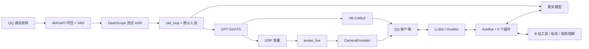

# 架构与边界

电话默认直连模型，与 AstrBot 的 QQ 文字会话并非同一条记忆链。`audio.use_astrbot_bridge` 可切换旧桥接入口，但桥接的 webchat 通道与 QQ 默认人设、长期记忆不能仅凭连接成功就视作相同，需独立实测。

`companion` 管主动行为，`qq_power` 管群与空间操作，`stickers` 管表情，`voice_picker` 管语音选择，`bili_scroll` 管 B 站。
各插件加载于用户自己的 AstrBot 环境。系统服务和外部软件单独安装。

独立脚本通过可编辑安装的 `ohwhale.config` 读取仓库配置。迁移项目后重新 `pip install -e .`，并核对显式绝对路径项；默认相对路径以 `OHWHALE_HOME` 或项目根为基准，不以当前命令行目录为基准。
